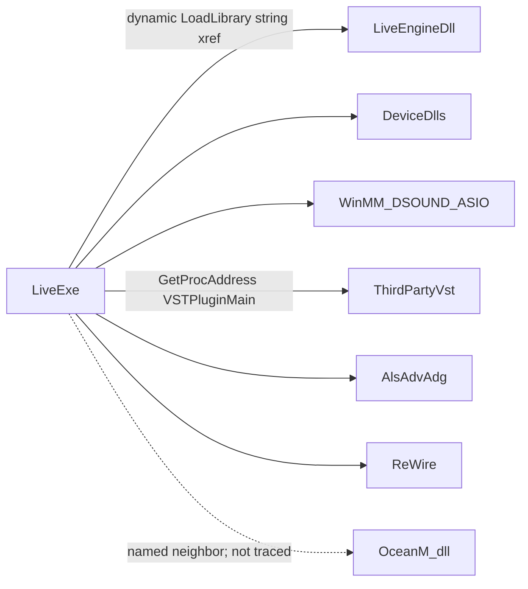
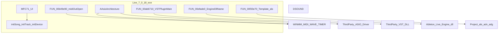

# Ableton Live 7.0.18 Windows - Read-only architecture map

**Target:** `C:\Program Files (x86)\Ableton\Live 7.0.18\Program\Live 7.0.18.exe`  
**Method:** REA + Ghidra 12.1.4 static analysis only (ephemeral import; original install bytes unchanged).  
**Date:** 2026-10-20  
**Scope priority:** audio processing, MIDI scheduler, VST host, project serialization.  
**Excluded:** licensing / authorization / unlock logic (including `OceanM.dll` beyond naming it as a separate boundary).

All conclusions distinguish **observation**, **inference**, and **unknown**. Static findings are never claimed as runtime execution.

---

## 1. Executive summary

`Live 7.0.18.exe` is a large **PE32 / x86 / Windows GUI** MFC application (~25.95 MB) with stripped symbols and no PDB. Ghidra recovered **214,193 procedures** and **31,950 defined strings** over an image base of `0x400000`.

The executable is the primary host for:

- **Audio I/O:** ASIO (Steinberg client embedded in the EXE), WinMM wave, DirectSound (ordinal imports).
- **MIDI I/O / timing:** WinMM MIDI + multimedia timers.
- **VST hosting:** `VSTPluginMain` string with a code xref inside the EXE.
- **Project serialization:** `.als` / `.adv` / `.adg`, zlib, and domain type names (`Song`, `LiveDocument`, clips/tracks).
- **Dynamic companion load:** string `Ableton Live Engine.dll` with a code xref (not a PE import).

---

## 2. Finding ledger

| ID | Conclusion | Evidence type | Evidence IDs / anchors | Confidence | Search boundary | Remaining unknowns |
|----|------------|---------------|------------------------|------------|-----------------|--------------------|
| F1 | Image is PE32 x86 GUI application, image base `0x400000`, entry RVA `0x30a3d8` | header + Ghidra overview | PE parse; `ev_242b5760...` overview | **high** | EXE only | Build toolchain beyond MSVC7/MFC71 |
| F2 | Six PE sections (`.text`, `.text1`, `.rdata`, `.data`, `.data1`, `.rsrc`); Ghidra also maps Headers + `tdb` | header + segments | PE sections; overview segments | **high** | EXE | Exact section permission flags beyond PE chars |
| F3 | No PDB; internal symbols largely stripped; 14 printable exports are `init*` domain hooks | header + procedure search | PE exports; `initSong` @ `0x131aa10` (`ev_3c8d3771...`) | **high** | EXE | Call graph into/from most `init*` (no resolved callers for `initSong`) |
| F4 | Static imports include WINMM, DSOUND, OLE32, MFC71, MSVCR71, KERNEL32, WS2_32, WININET; **no** `Ableton Live Engine.dll` import | import table | PE import dump | **high** | EXE IAT | Delay-load table not separately enumerated |
| F5 | Engine DLL is dynamically loaded from the EXE | string + xref + containing proc | `Ableton Live Engine.dll` @ `0x16c74a0` (`ev_73019f24...`); xref `0xefae0d` (`ev_a368485e...`); `FUN_00efade0` (`ev_2255c480...`) | **high** | EXE | Exact GetProcAddress export names used after load |
| F6 | Audio path: ASIO client classes live in the EXE; WinMM wave + DSOUND also imported | strings + imports + RTTI | ASIO inventory (`ev_162700e6...`); `AAsioArchitecture` @ `0x175ca58`; WINMM wave*; DSOUND ordinals 1,2,6,7 | **high** (ASIO/WinMM); **medium** (DSOUND ordinal mapping) | EXE strings/IAT | Which backend is default; mapping of DSOUND ordinals to API names |
| F7 | MIDI scheduler boundary uses WinMM MIDI + timers; domain model names clips/tracks/songs | imports + callers + strings | `WINMM.DLL::midiOutOpen` callers -> `FUN_00b49e90` (`ev_ae38716b...`, `ev_541bfcd6...`); type strings `MidiClip`, `MidiTrack`, `MidiNoteEvent` | **high** | EXE | Full real-time scheduling algorithm |
| F8 | VST host entry discovery uses `VSTPluginMain` | string + xref + containing proc | `VSTPluginMain` @ `0x1771144` (`ev_dd83da6c...`); xref `0xab67fb` (`ev_831793c2...`); `FUN_00ab6710` (`ev_c33f0753...`); Steinberg credit string | **high** | EXE | Full `AEffect` dispatch table layout |
| F9 | Project serialization uses Ableton Live Set / `.als` / device packs + zlib | strings + multi-xrefs | `Template.als` @ `0x1629cbc` (`ev_829c02f3...`) xrefs include `FUN_00f33e70` (`ev_c9c30b71...`, `ev_0aa0d250...`); `Ableton Live Set`; `zlib compression`; `.adv`/`.adg` | **high** | EXE | On-disk schema (XML vs proprietary blob) not proven from strings alone |
| F10 | Domain object taxonomy is embedded as type-name catalogs | strings | `Song,SampleSong,...LiveDocument`; clip/track/device group names | **medium** | EXE `.rdata` | Mapping of each name to concrete C++ class layout |
| F11 | Device DLLs (`Analog`/`Electric`/`Tension`) and `AudioRipper.ax` are install neighbors | filesystem inventory | install tree under `Resources/Devices/Pc` | **medium** | install layout | Whether loaded via same device host as VST or a private ABI |
| F12 | `OceanM.dll` is a separate small module referenced by LoadLibrary failure strings | strings | `OceanM.dll`, `OceanMidi.dll` failure text | **low** (role); boundary named only | EXE strings | Any non-licensing function - **not investigated** |

---

## 3. Image identity and layout

### 3.1 Identity (observation)

| Field | Value |
|-------|-------|
| Path | `.../Program/Live 7.0.18.exe` |
| Size | 25,952,256 bytes |
| SHA-256 | `f91bb164e1fe365f7167b13addad8b27e98955756817a712947de5ca3f44f40a` |
| Machine | `IMAGE_FILE_MACHINE_I386` (`0x14c`) |
| Format | PE32 |
| Subsystem | Windows GUI |
| Image base | `0x400000` |
| Entry point RVA | `0x30a3d8` |
| Characteristics | `0x12F` (executable, 32-bit, stripped) |
| PDB | Absent (Ghidra: Skipping PDB processing) |
| Language (Ghidra) | `x86:LE:32:default:windows` |

### 3.2 PE sections (observation)

| Name | Virt size | Virt addr | Raw size |
|------|-----------|-----------|----------|
| `.text` | 18,670,196 | `0x1000` | 18,673,664 |
| `.text1` | 1,464 | `0x11d0000` | 4,096 |
| `.rdata` | 5,486,953 | `0x11d1000` | 5,488,640 |
| `.data` | 2,744,064 | `0x170d000` | 1,736,704 |
| `.data1` | 15,248 | `0x19ab000` | 16,384 |
| `.rsrc` | 27,832 | `0x19af000` | 28,672 |

Ghidra segment inventory (`ev_242b5760...`): Headers, the six PE sections remapped at image base, plus a `tdb` block - **procedure_count 214193**, **string_count 31950**.

---

## 4. Imports, exports, and symbol surface

### 4.1 Imported libraries (observation)

18 DLLs in the IAT, including:

| DLL | Import count (approx.) | Likely boundary |
|-----|------------------------|-----------------|
| `KERNEL32.dll` | 126 | threads, files, `LoadLibraryA`/`ExA`, mappings |
| `MFC71.DLL` | 249 | UI / document framework |
| `MSVCR71.dll` / `MSVCP71.dll` | 207 / 40 | CRT / STL (VS 2003-era) |
| `USER32.dll` / `GDI32.dll` | 95 / 10 | window |
| `WINMM.dll` | 40 | MIDI + wave + `timeSetEvent` |
| `DSOUND.dll` | 4 (ordinals 1,2,6,7) | DirectSound |
| `ole32.dll` | 8 | COM (`CoCreateInstance`, OLE init) |
| `WS2_32.dll` | 31 | networking |
| `WININET.dll` | 4 | HTTP(S) client |
| `DDRAW.dll` | 2 | DirectDraw (likely UI/video path) |

**Not present as static imports:** `Ableton Live Engine.dll`, ASIO driver DLLs, VST plugins, device instrument DLLs.

### 4.2 Exports (observation)

| Ordinal | Name |
|---------|------|
| 1-14 | `initApplication`, `initClip`, `initClipSlot`, `initDevice`, `initDeviceParameter`, `initLive`, `initMidiMap`, `initMidiRemoteScript`, `initMixerDevice`, `initScene`, `initSong`, `initStringConversion`, `initTrack`, `initmsvcrt` |

**Inference (medium):** These look like registration/bootstrap hooks for Live object model (song/track/clip/device/MIDI remote), not the audio realtime callback itself. Ghidra found **no resolved direct callers** of `initSong` (`ev_397f6680...`) - likely taken by address/export table.

### 4.3 Companion modules (observation + inference)

| Module | Size | Role (evidence) |
|--------|------|-----------------|
| `Ableton Live Engine.dll` | 3,293,184 | Dynamically loaded by EXE (F5); also embeds ReWire/ASIO/VST-related strings |
| `OceanM.dll` | 5,632 | Named in LoadLibrary failure strings; **licensing adjacency - not analyzed** |
| `AudioRipper.ax` | 61,440 | DirectShow filter neighbor |
| `Resources/Devices/Pc/*.dll` | ~450-540 KB each | Built-in instrument devices |

---

## 5. Priority subsystem maps

### 5.1 Audio processing engine

**Observations**

- Rich ASIO client surface in the EXE: `AAsioArchitecture`, `AAsioDevice`, `loadAsioDriver`, `ASIOStart`/`ASIOStop`, buffer/sample-type conversion strings (`ev_162700e6...`).
- WinMM wave path: `waveOutOpen`/`waveOutWrite`/`waveIn*` imported; `waveOutWrite` present as `WINMM.DLL::waveOutWrite` (`ev_51f6ade5...`).
- DirectSound: four ordinal imports from `DSOUND.dll`.
- Default device string: `Default DirectSound Device`.
- Engine DLL string `OEngine.OSetSampleRate` / ReWire sample-rate helpers (raw string scan of engine binary).

**Inferences**

- The **ASIO host client is compiled into the EXE**, not outsourced solely to the engine DLL (**high**).
- Multiple audio backends coexist; selection is preference/driver driven (**medium**).
- `Ableton Live Engine.dll` is a related realtime/ReWire peer loaded at runtime (**high** for load; **medium** for exact audio responsibility split).

**Unknowns**

- Exact audio callback entry and buffer graph topology.
- Ordinal-to-API mapping for DirectSound without a matching exports file.

### 5.2 MIDI scheduler

**Observations**

- Full WinMM MIDI API surface: `midiIn*` / `midiOut*`, plus `timeSetEvent` / `timeBeginPeriod` / `timeGetTime`.
- Direct caller of `midiOutOpen`: procedure `FUN_00b49e90` @ `0xb49e90`.
- Domain strings: `MidiClip`, `MidiTrack`, `MidiNoteEvent`, `MidiIn/Track.`, `MidiOut/Track.`, remote script init export.

**Inferences**

- MIDI device open/close is WinMM-backed inside the EXE (**high**).
- Scheduling uses multimedia timers in addition to audio-driver clocks (**medium**).
- Clip/track model is first-class (string taxonomy) (**medium**).

**Unknowns**

- Tick/quantum algorithm and interaction with ASIO time info (`AsioSupportsTimeInfo` present as string only).

### 5.3 VST host

**Observations**

- String `VSTPluginMain` @ `0x1771144` referenced from `FUN_00ab6710` @ `0xab6710`.
- Marketing/credit string ties ASIO + VST to Steinberg.
- Related strings: `VstDeviceParam`, `VstAsioCommand`, plugin scan prefs (`PluginScanVerbose`, `NoVstStartupScan`) also appear in the engine DLL string space.
- OLE/COM imports available for ActiveX-style plugin UI hosting (**possible**, not proven for VST editor path).

**Inferences**

- Third-party VST modules are loaded dynamically; entry symbol sought is `VSTPluginMain` (**high**).
- Host implementation is primarily in the EXE function around `FUN_00ab6710` (**high** for entry discovery; **medium** for full host feature set).

**Unknowns**

- Complete `audioMaster` callback and effect opcode dispatch.
- Bridge between Live `Device` model and `AEffect`.

### 5.4 Project serialization

**Observations**

- `Template.als` / `OldTemplate.als`; product string `Ableton Live Set`.
- Device/pack extensions `.adv`, `.adg` (and related Ableton extensions in raw scans).
- Embedded zlib 1.2.2 banners + `zlib compression`.
- Type catalog includes `Song` / `LiveDocument` / clip and device variants.
- Multiple code xrefs to `Template.als`, including `FUN_00f33e70` @ `0xf33e70`.

**Inferences**

- Live sets are file-backed Ableton documents with compression (**high**).
- Serialization logic resides in the EXE (not a separate serializer DLL in the IAT) (**high**).

**Unknowns**

- Whether `.als` on disk is gzip-wrapped XML (common in later Live) versus another container - **not proven** here (no `<?xml` literal hit in bounded search).

---

## 6. Subsystem boundary diagram (evidence-backed)

Edges shown are supported by import, string, and/or xref evidence above. Dashed concerns (device DLLs, OceanM) are install/name neighbors without a completed load-path xref in this pass.

---

## 7. Coverage and limitations

**Completed**

- Architecture, PE sections, IAT/EAT, Ghidra inventory counts.
- Bounded string searches for ASIO/MIDI/VST/serialization/engine module name.
- Xrefs + containing procedures for VST entry, engine DLL name, MIDI open, template set.
- Companion file inventory (engine/OceanM/devices) without running them.

**Not completed / residual unknowns**

- Full decompilation of realtime audio graph.
- Engine DLL export ABI (PE export names not recovered as clean ASCII in this pass).
- Device DLL private ABI.
- Any licensing mechanism beyond noting `OceanM.dll` as out of scope.
- Runtime confirmation (intentionally omitted).

**Artifacts (workspace only)**

- `analysis/live7/pe_header_imports.json`
- `analysis/live7/string_anchors.json` / `string_anchors_curated.json`
- `analysis/live7/analyze3.json` (Ghidra overview evidence)
- `analysis/live7/live718.snapshot` (REA analysis snapshot)
- `analysis/live7/companion_pe.json` (raw companion PE parse)

---

## 8. Evidence index (short)

| Evidence ID (prefix) | Operation | Notes |
|----------------------|-----------|-------|
| `ev_242b5760` | `binary_overview` | segments, 214193 procs, 31950 strings |
| `ev_dd83da6c` | `search_strings` | `VSTPluginMain` |
| `ev_831793c2` / `ev_c33f0753` | `xrefs` / `resolve_containing_procedure` | VST host fn `FUN_00ab6710` |
| `ev_73019f24` / `ev_a368485e` / `ev_2255c480` | string / xref / proc | Engine DLL loader `FUN_00efade0` |
| `ev_829c02f3` / `ev_c9c30b71` / `ev_0aa0d250` | string / xref / proc | `Template.als` / `FUN_00f33e70` |
| `ev_162700e6` | `search_strings` | ASIO surface |
| `ev_ae38716b` / `ev_541bfcd6` | callers / resolve | `midiOutOpen` -> `FUN_00b49e90` |
| `ev_3c8d3771` | `search_procedures` | `initSong` @ `0x131aa10` |
| `ev_0c5d1aa9` / `ev_2d68a4ed` | strings | zlib / Ableton Live Set |

Provider: **Ghidra 12.1.4** via REA (`rea-agents` 6.7.0). Analysis profile digest `3de5374fadd78e0d56219c4afc6b4f2efac7101ff92b72faf375fb0070bbc896`.
