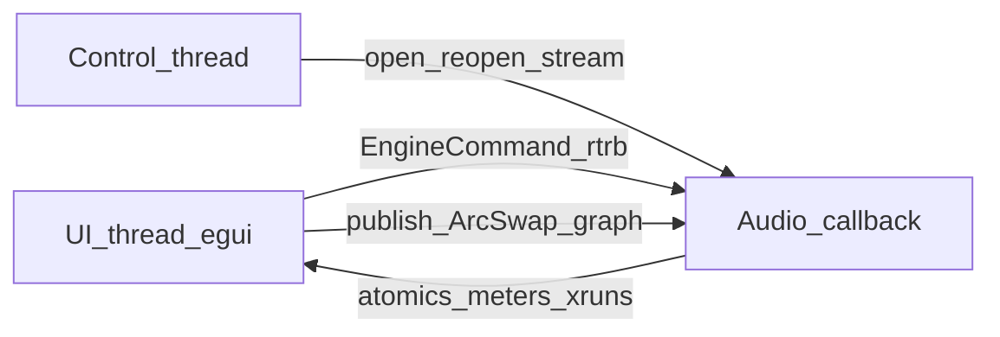

# ArcLive Architecture

## Purpose

ArcLive is an original Rust digital audio workstation. Research notes about Ableton
Live 7.0.18 ([live7-architecture.md](live7-architecture.md)) inform **boundaries**
(host vs engine, multi-backend audio, clip/track taxonomy). They do not define
callback topology, scheduling algorithms, or on-disk schemas. Those subsystems are
designed here and marked as such.

## Verified research findings (boundaries only)

| Finding | Confidence | ArcLive response |
|---------|------------|------------------|
| Host EXE owns UI, ASIO client, MIDI, VST entry, serialization; engine DLL loaded dynamically | high | UI never owns the audio callback; `arclive-engine` is a separate crate |
| Multiple audio backends coexist | high | Portable host API (`cpal`); platform default first |
| Domain type names: Song, Track, Clip, Scene, ClipSlot, Device, Mixer | medium (names only) | Original Rust model with the same *concepts* |
| Projects compressed (`.als` / zlib); schema unproven | high / unknown | Original `.arclive` JSON format; no `.als` I/O |
| Real-time graph, MIDI quantum, VST dispatch, launch quantization | **unknown** | Original designs in [audio-engine.md](audio-engine.md) |

Out of scope from research: ReWire, licensing modules, Ableton branding/assets.

## Crate map

```text
arclive-core      ids, musical time, transport, song / track / clip model
arclive-engine    cpal I/O, process graph, mixer, session, timeline, devices
arclive-project   versioned document + migrations
arclive-ui        egui shell (no dependency on engine)
arclive-app       binary; owns threads and bridges UI ↔ engine
```

Dependency direction: `project` → `core`, `engine` → `core`, `ui` → `core`,
`app` → `{ui, engine, project}`. The UI never links the engine.

## Threads



- **UI thread:** egui/eframe; sends `Copy` commands; reads atomics and snapshots.
- **Audio callback:** `Engine::process` only; no alloc, mutex, I/O, or `tracing`.
- **Control path (app):** opens/reopens cpal streams when devices change or faults occur.

## Domain model (original)

- `Song`: tempo, time signature, tracks, scenes, arrangement clips, transport prefs.
- `AudioTrack` / `MidiTrack`: mixer channel (gain, pan, mute, solo), device chain, clip slots.
- `Scene`: row of clip launches across tracks.
- `ClipSlot`: optional audio or MIDI clip reference.
- `ArrangementClip`: clip placed on a timeline lane with start/length in beats.
- `Transport`: Stopped | Playing | Recording; sample position; loop range.

## Project persistence

`Name.arclive/project.json` + `assets/`. Schema version integer with ordered migrations.
Missing assets become explicit placeholders. Autosave: `project.autosave.json`.

## Design principles

1. Small vertical slices over empty crate sprawl.
2. Engine testable without a window (`process` unit tests).
3. Cross-platform adapters at the edge; core logic is OS-agnostic.
4. Document tested platforms honestly in [progress.md](progress.md).
